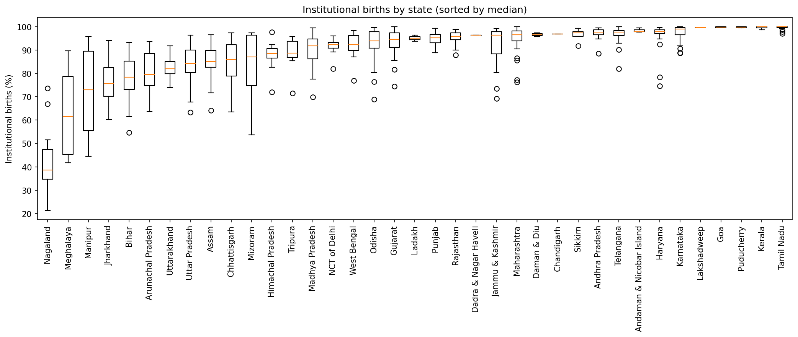
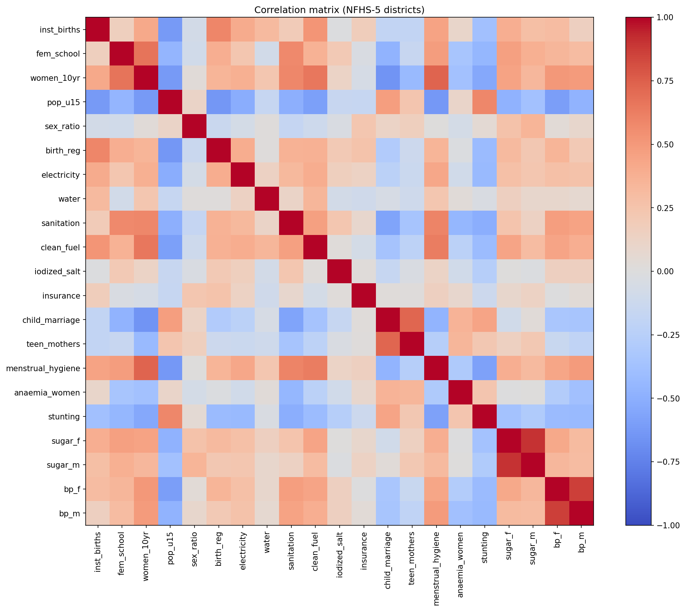
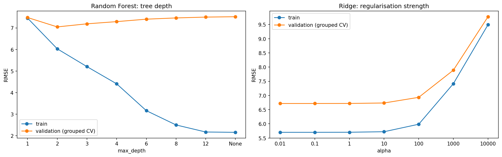
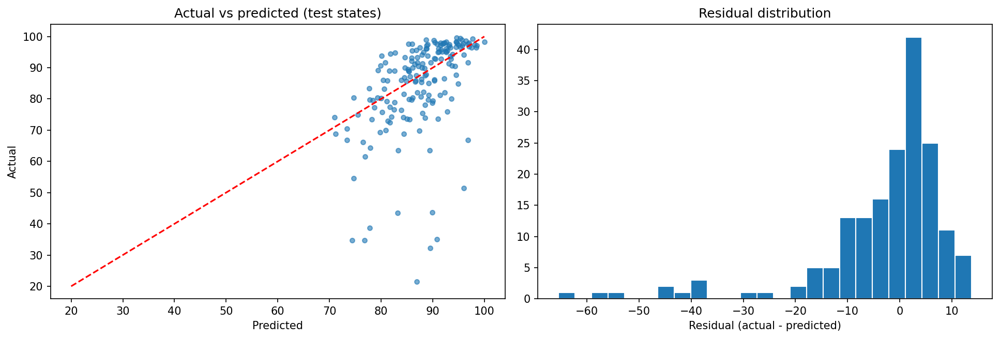
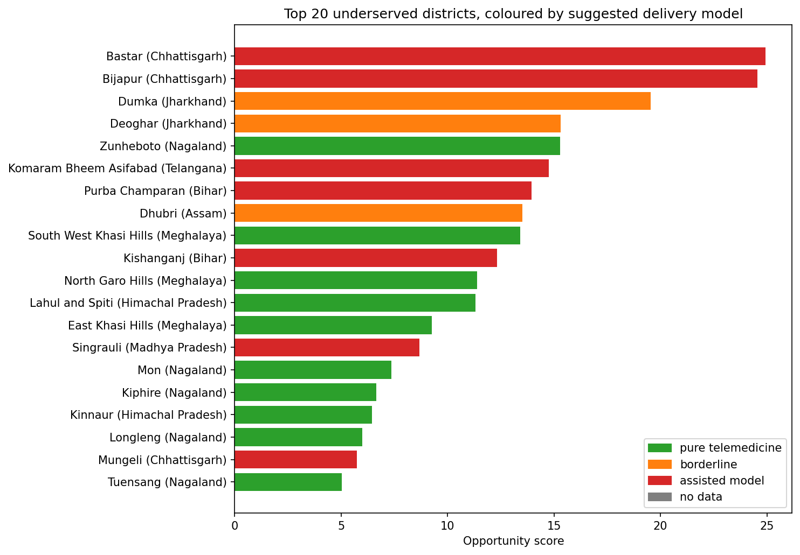

# Where Should a Healthtech Startup Launch First? A District-Level Opportunity Analysis of India

[](https://colab.research.google.com/github/YOUR_USERNAME/idse-india-healthtech-opportunity/blob/main/notebooks/idse_district_opportunity.ipynb)

**Course:** IDSE, Data Science Project (Part A) | **Author:** [your name] | **Roll no.:** [roll no.]

---

## Summary

A telemedicine or primary-care startup cannot serve all of India at once, so it has to choose where to pilot first. This project uses NFHS-4 and NFHS-5 district data (707 districts in 37 states and union territories) to answer one question:

> **Which districts have much lower access to institutional healthcare than their socioeconomic conditions predict, and also high health need, so that they are the best candidates for a first pilot?**

Approach in one line: predict the share of births that *should* happen in a health facility, compare it with what *does* happen, and treat the shortfall, weighted by nutrition burden, as the opportunity. A state-level digital-readiness check then says whether each district suits pure telemedicine or an assisted model (a local health worker plus a remote doctor).

## Key results

- A **state-grouped Ridge model** predicts institutional births with a cross-validated RMSE of **6.74 percentage points** on unseen states, against 10.67 for a mean baseline (R-squared 0.37 against -0.58).
- On 8 held-out test states the Ridge RMSE is 13.49 overall but **7.34 without Nagaland**. Nagaland alone has an RMSE of 44.8 because its districts lie below the range of any training state.
- A **Random Forest overfits** (training RMSE 2.16, validation 7.51 at unlimited depth), so the simpler linear model was kept.
- Of 707 districts, **33 have a shortfall of at least 13.5 percentage points**. **Nine** stay on the list under a stricter threshold (twice the out-of-fold error, 18.3 points).
- **Bastar, Bijapur (Chhattisgarh) and Dumka (Jharkhand)** combine a gap of 21-25 points with among the highest nutrition burdens, and survive the strict test.
- Rural internet use is low in the Chhattisgarh districts (20.8% of rural women have ever used the internet, against a national 24.6%), so an **assisted model** is more realistic there than pure telemedicine.

### Model comparison (final feature set, without `birth_reg`)

| Model | CV RMSE | CV R-squared | Test RMSE | Test R-squared |
|---|---|---|---|---|
| Baseline (mean) | 10.67 | -0.58 | 15.83 | -0.13 |
| Linear (OLS) | 6.74 | 0.37 | 13.48 | 0.18 |
| **Ridge (final)** | **6.74** | **0.37** | **13.49** | **0.18** |
| Random Forest | 7.14 | 0.35 | 14.19 | 0.09 |

Cross-validation used `GroupKFold` by state on the 29 training states. The test set (174 districts in 8 states) was used once. Differences between OLS, Ridge and Random Forest are within fold-to-fold variation, so no claim is made that one is significantly better.

### Strongest candidates (survive the strict threshold)

| District | State | Actual (%) | Expected (%) | Gap (pp) | Burden percentile | Rural women using internet (state) | Suggested model |
|---|---|---|---|---|---|---|---|
| Bastar | Chhattisgarh | 63.5 | 88.7 | 25.1 | 0.99 | 20.8% | Assisted |
| Bijapur | Chhattisgarh | 63.6 | 88.3 | 24.7 | 1.00 | 20.8% | Assisted |
| Dumka | Jharkhand | 60.3 | 82.2 | 21.9 | 0.89 | 22.7% | Borderline |
| Zunheboto | Nagaland | 35.0 | 88.5 | 53.5 | 0.29 | 40.3% | Telemedicine |
| North Garo Hills | Meghalaya | 61.5 | 80.3 | 18.8 | 0.61 | 28.0% | Telemedicine |
| Mon | Nagaland | 21.4 | 85.6 | 64.2 | 0.11 | 40.3% | Telemedicine |
| Kiphire | Nagaland | 34.8 | 77.5 | 42.7 | 0.16 | 40.3% | Telemedicine |
| Longleng | Nagaland | 38.7 | 79.8 | 41.1 | 0.15 | 40.3% | Telemedicine |
| Tuensang | Nagaland | 34.8 | 75.3 | 40.5 | 0.12 | 40.3% | Telemedicine |

The full top 20 is in `outputs/district_opportunity_with_connectivity.csv`. Nagaland's gaps are the largest, but its measured nutrition burden is low and part of the gap may be model error, so Nagaland needs a separate, access-focused analysis and local validation.

## Figures

**State-wise institutional births.** State is the strongest influence, which is why validation splits by state.



**Correlation matrix.**



**Overfitting analysis.** The Random Forest memorises training districts; Ridge is stable.



**Actual against predicted values on the held-out states.** The long tail of errors is Nagaland.



**Top 20 underserved districts, coloured by suggested delivery model.** Green: pure telemedicine. Orange: borderline. Red: assisted model.



## Data

| Data | Source | Used for |
|---|---|---|
| NFHS-5 (2019-21) and NFHS-4 (2015-16) district factsheets | International Institute for Population Sciences (IIPS), via the CSV conversion in [`SaiSiddhardhaKalla/NFHS`](https://github.com/SaiSiddhardhaKalla/NFHS) | Main dataset (`India.csv`) |
| NFHS-5 state factsheets (internet and mobile use) | [`pratapvardhan/NFHS-5`](https://github.com/pratapvardhan/NFHS-5) (`NFHS-5-States.csv`) | Digital-readiness overlay |

The data are **not stored in this repository**. The notebook downloads them at run time. Check each source's licence and terms before redistributing any of it. The original reports are published by IIPS.

Citation: IIPS and ICF. *National Family Health Survey (NFHS-5), 2019-21.* Mumbai: IIPS.

Because the district CSV was produced by automatic conversion from PDFs, it was validated before use. Three problems were found and handled (details in Step 3 of the notebook):

1. Saraikela-Kharsawan was mislabelled as a second Sahibganj. It was relabelled, not dropped.
2. One indicator for Surajpur had two conflicting values, so both rows were dropped (not used in the model).
3. Chandigarh and Lakshadweep had implausible values in three variables, which were set to missing; the other variables of those rows were kept.

## Method (9-step pipeline)

| Step | What happens |
|---|---|
| 1. Problem definition | Business question, measurable goals, hypotheses |
| 2. Data collection | Sources, structure, data dictionary |
| 3. Cleaning | Long-to-wide reshape, name cleaning, hidden zeros treated as missing, labelling errors fixed, outliers examined and kept unless impossible |
| 4. EDA | Descriptive statistics, histograms, correlation matrix, scatter plots, state comparison, each with a written insight |
| 5. Feature engineering | Three composite indices; burden scores kept out of the model |
| 6. Inferential statistics | Welch t-test, Mann-Whitney, 95% confidence intervals, correlation tests with Bonferroni adjustment, chi-square |
| 7. Modelling | State-wise split, mean baseline, OLS, Ridge, Random Forest, grouped CV, tuning, preprocessing inside pipelines |
| 8. Evaluation | Test-set results, overfitting curves, residual analysis, NFHS-4 to NFHS-5 check, diagnostics |
| 9. Ranking and conclusions | Out-of-fold expected access, opportunity score, robustness, connectivity overlay, limitations, next steps |

**Target:** institutional births (%). **Model features:** 14 socioeconomic and infrastructure indicators plus 3 composite indices (17 candidates; the final model uses 16 after dropping birth registration, which may partly follow from the target). **Burden indicators** (anaemia, stunting, blood sugar, blood pressure) are used only for ranking, never as inputs.

## Repository structure

```
idse-india-healthtech-opportunity/
├── README.md
├── requirements.txt
├── .gitignore
├── notebooks/
│   └── idse_district_opportunity.ipynb
├── figures/
│   └── fig1 to fig5 (PNG)
└── outputs/
    ├── district_opportunity_with_connectivity.csv
    └── model_comparison_cv.csv
```

## How to run

**In Colab (recommended):** click the badge at the top, then choose *Runtime, Restart session and run all*. The notebook clones the two data repositories itself. It runs top to bottom with no manual steps.

**Locally:** the notebook uses `!git clone` commands and a Colab download in the last cell, so it is written for Colab. To run it elsewhere, clone the two data repositories next to the notebook (`NFHS/` and `nfhs5_states/`), install the requirements and skip the last cell.

```
pip install -r requirements.txt
```

## Reproducibility

- Random seed `RANDOM_STATE = 42` for the train/test split, cross-validation and Random Forest.
- All preprocessing (median imputation, scaling) sits inside scikit-learn pipelines and is fitted on training folds only.
- Train and test states are disjoint (checked with an `assert`).
- The test set was used once, after models were selected by cross-validation. The seed and split were not changed after seeing results.
- Package versions are in `requirements.txt`. The notebook ran on Python 3.13 in Colab.

## Limitations

- Institutional births are a **proxy** for access. The data have no doctor or facility counts, so supply is not measured directly.
- District values are **survey estimates** with sampling error, larger in small districts.
- A large negative residual is an **association**. It can reflect under-service or an unmeasured factor such as terrain or state policy.
- **Nagaland** lies outside the range of the training states, so the model cannot extrapolate there (test RMSE 44.8, against 7.34 for the other test states).
- The test set is small (8 states, 174 districts).
- The manual fixes to the converted source file should be confirmed against the original IIPS PDFs.
- The connectivity measure is **state-level, rural, women only**, from 2019-21. It is not network coverage or smartphone ownership.
- Blood sugar and blood pressure appear to track screening and affluence rather than need (a hypothesis, not tested), so they are not part of the main burden score.
- No population or willingness-to-pay data, so the **market cannot be sized**.

## Next steps

1. Merge Census population and HMIS facility counts to size demand and measure supply directly.
2. Add district-level connectivity (smartphone ownership, mobile-network coverage).
3. Add bootstrap confidence intervals to the gaps.
4. Try gradient boosting and spatial cross-validation.
5. Validate the top districts with local health officials.

## Mapping to the project rubric

| Rubric criterion | Where it is covered |
|---|---|
| Problem and data | Steps 1-2: measurable question, sourced and justified dataset |
| Data preparation and EDA | Steps 3-5: reasoned cleaning, outlier decisions, feature engineering, annotated plots |
| Modelling / analysis | Steps 6-7: inferential tests, baseline plus two model families, state-grouped split and CV with no leakage, tuning |
| Evaluation and interpretation | Step 8 and 9: right metrics, model comparison, residual and overfitting analysis, limitations, next steps |
| Reproducibility and code quality | Fixed seed, `requirements.txt`, this README, notebook runs end to end |
| Report and presentation | Written conclusions in each step; business reading in Step 9 |
